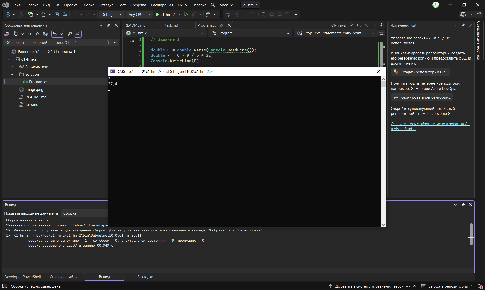
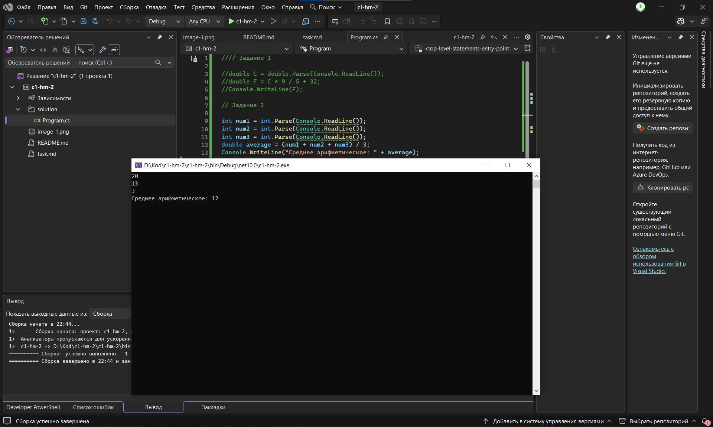
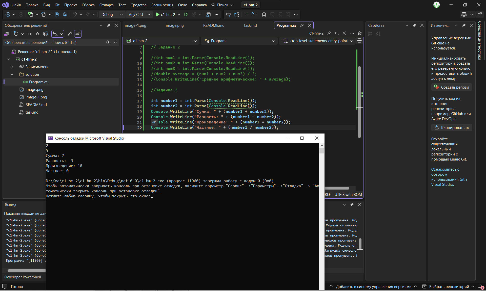

# В этом домашнем задании я сделал 3 номера

## 1 - Пользователь вводит температуру в Цельсия, переводим её в градусы Фаренгейта по формуле F = C * 9 / 5 + 32 и выводит результат
	

## 2 - Пользователь вводит 3 числа, программа их складывает и делит на 3, после выводит результат
	

## 3 - Пользователь вводит 2 числа, программа выводит сумму, разность, произведение и частное этих чисел
    

### Результат можно проверить запустив программу